# 📄 PDF OCR to Excel Converter & PAC Interne Automation

<p align="center">
  
  
  
  
  
  
  
</p>

<p align="center">
  
  &nbsp;&nbsp;&nbsp;&nbsp;&nbsp;&nbsp;&nbsp;&nbsp;&nbsp;&nbsp;&nbsp;&nbsp;&nbsp;&nbsp;
  
</p>

---

## 📌 Présentation Générale

**PDF OCR to Excel Converter** est une solution logicielle complète développée en **Python (Flask)** pour automatiser la chaîne de traitement, d'extraction, de conversion et d'analyse budgétaire des **Bons de Commande (BDC)** numérisés sous forme d'images ou de PDF scannés.

Conçu et validé en conditions réelles au sein de la **Direction des Systèmes d'Information & Infrastructure d'ORANGE Maroc (MEDITELECOM)**, ce système permet de remplacer la saisie manuelle fastidieuse et sujette aux erreurs par un pipeline d'ingénierie documentaire intelligent :
1. **Reconnaissance Optique de Caractères (OCR)** basée sur l'apprentissage profond (**EasyOCR**) pour extraire avec précision les métadonnées (fournisseurs, numéro de commande/contrat, dates) et les tableaux d'articles (désignations, quantités, prix unitaire, prix total).
2. **Interface Web interactive (Flask)** permettant la vérification humaine, la modification à la volée et la validation des données extraites.
3. **Génération automatisée de classeurs Excel multi-onglets structurés**, avec une feuille dédiée par bon de commande et calculs arithmétiques automatiques.
4. **Tableau de bord budgétaire consolidé ("Main")** offrant une vue macroscopique et en temps réel des budgets engagés par fournisseur et contrat.
5. **Génération automatisée de Procès-Verbaux de Réception ("PAC Interne")** via une macro VBA intégrée (`PACInterneModule`) et automatisation Word (`python-docx` / `win32com`).

---

## 👥 Cadre Académique & Professionnel

| Information | Détails |
|---|---|
| **Établissement** | **EMSI** — École Marocaine des Sciences de l'Ingénieur (Filière Informatique et Réseaux) |
| **Organisme d'Accueil** | **ORANGE (MEDITELECOM)** — Direction des Systèmes d'Information & Infrastructure |
| **Service d'Accueil** | Solution Réingénierie des Sites & Projets Spéciaux |
| **Encadrant Professionnel** | **M. Rabii Hanif** (Manager Solution Réingénierie des Sites & Projets Spéciaux — Orange) |
| **Cadre du Mémoire** | Mémoire de Projet de Fin d'Année (3ème année — Session Septembre 2025) |
| **Année Universitaire** | 2024 – 2025 |

---

## 📸 Galerie & Démonstration Visuelle

### 1. Interface Web d'Importation & Drag & Drop
Zone de glisser-déposer intuitive permettant le téléversement simultané de plusieurs fichiers PDF scannés.
<p align="center">
  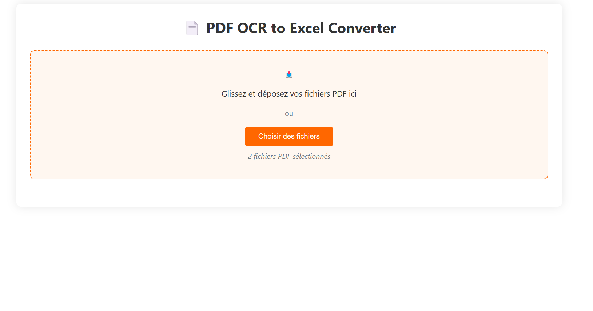
</p>

### 2. Traitement & Extraction OCR en Temps Réel
Conversion des pages PDF en images haute résolution avec **PyMuPDF**, puis détection et transcription textuelle via **EasyOCR**.
<p align="center">
  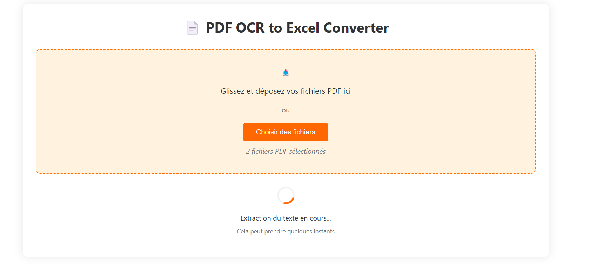
</p>

### 3. Contrôle & Validation des Données Extraites
Tableau web dynamique présentant les champs détectés (fournisseur, numéro BDC, contrat, date) et la liste détaillée des articles avec calcul automatique du total par ligne et possibilité d'édition manuelle.
<p align="center">
  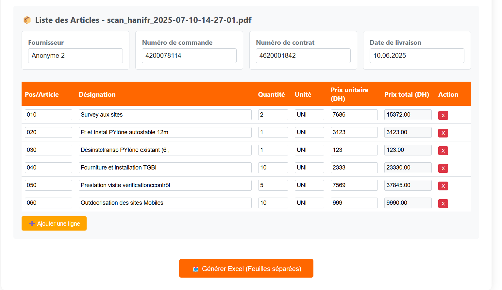
</p>

### 4. Classeurs Excel Multi-Onglets Générés
Génération automatique d'un onglet par bon de commande (nommé d'après le numéro de commande) avec mise en page soignée, calcul des totaux et bouton interactif **« PAC Interne »**.
<p align="center">
  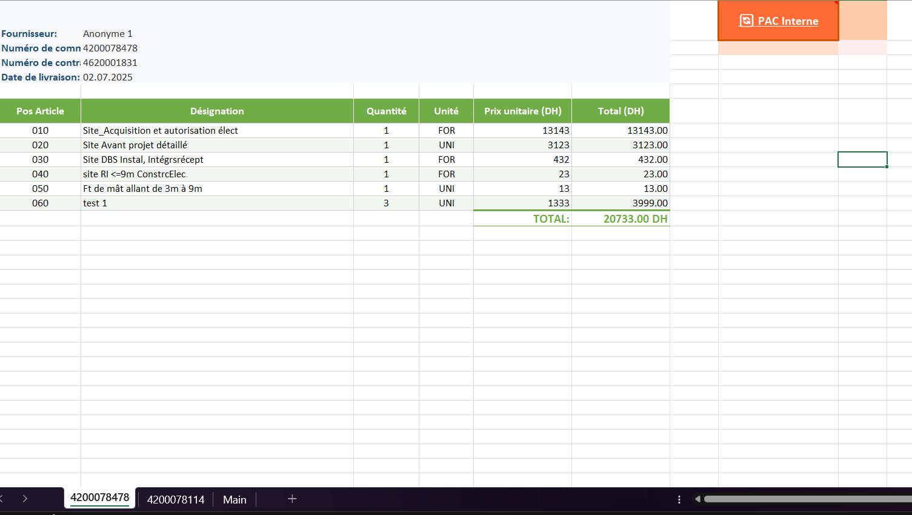
  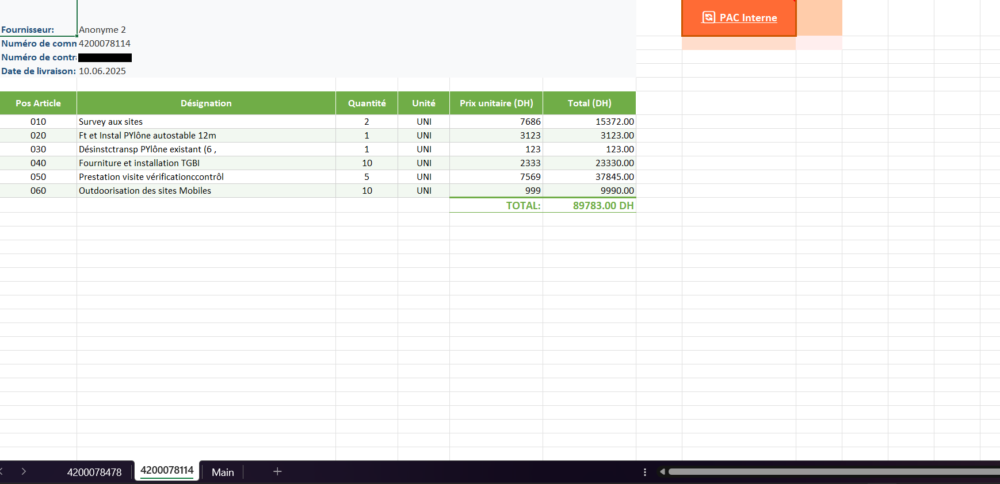
</p>

### 5. Procès-Verbal de Réception Interne ("PAC Interne")
Document officiel Word généré automatiquement au format contractuel de l'entreprise, intégrant les références du bon de commande, les articles réceptionnés et les encarts de signature.
<p align="center">
  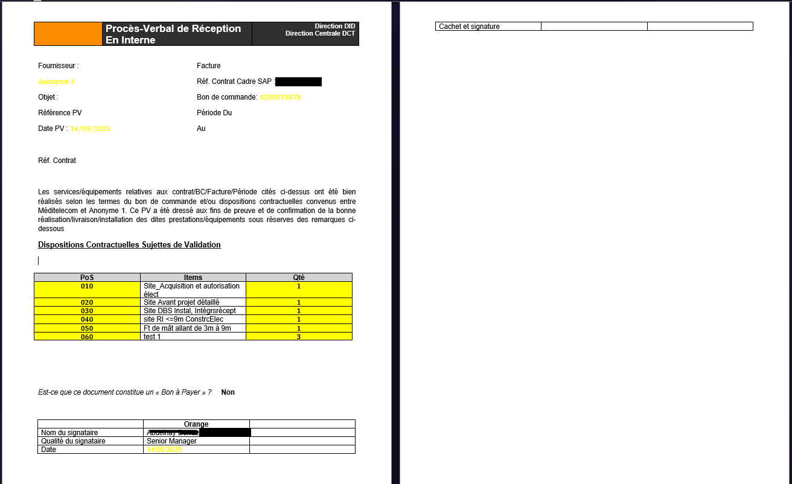
</p>

### 6. Tableau de Bord Budgétaire Consolidé (Feuille "Main")
Synthèse financière regroupant par fournisseur et contrat les montants engagés, réceptionnés et les reliquats pour un pilotage budgétaire instantané.
<p align="center">
  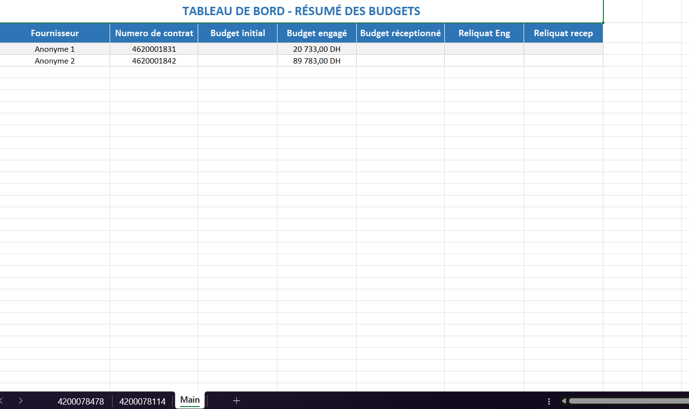
</p>

---

## 📐 Conception & Modélisation UML

### Diagramme de Séquence Global
<p align="center">
  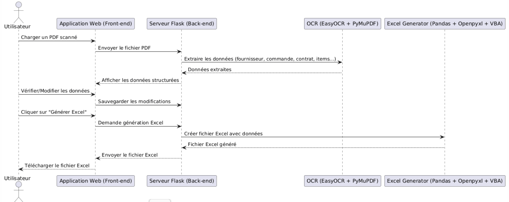
</p>

### Cycle de Vie du Fichier Excel & Activité du Système
<p align="center">
  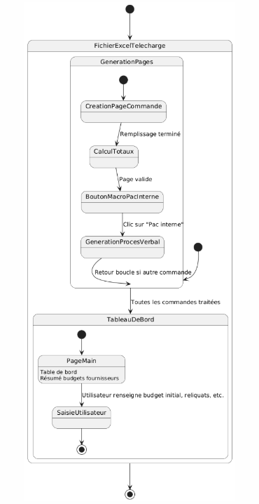
  &nbsp;&nbsp;&nbsp;&nbsp;
  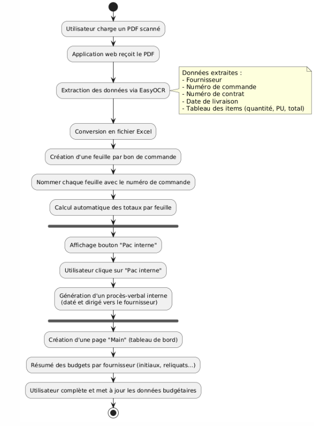
</p>

### Diagramme d'État-Transition
<p align="center">
  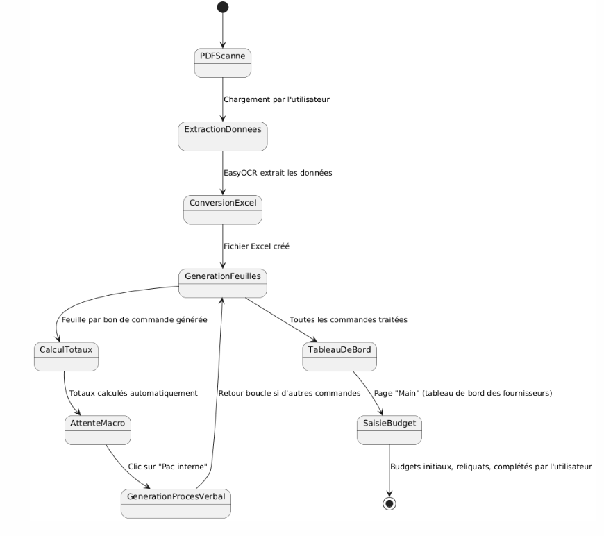
</p>

### Diagramme de Classes & Modèle Relationnel
<p align="center">
  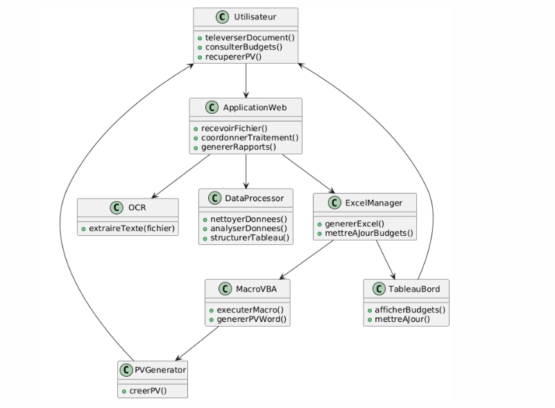
  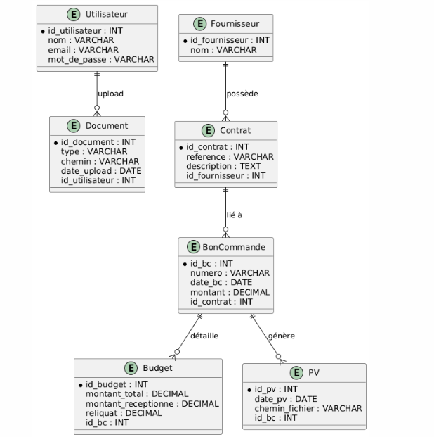
</p>

---

## 🛠️ Stack Technologique & Justification des Choix

| Composant | Technologie | Justification |
|---|---|---|
| **Backend & API** | **Python & Flask** | Micro-framework léger, asynchrone et modulaire permettant une intégration native avec les bibliothèques d'analyse de données et d'OCR. |
| **Moteur OCR** | **EasyOCR** (PyTorch) | Basé sur des réseaux de neurones profonds (CNN pour la détection spatiale + RNN/LSTM pour la reconnaissance). Supérieur à Tesseract sur des scans bruités, inclinés ou avec polices non standardisées. |
| **Prétraitement PDF** | **PyMuPDF (`fitz`)** | Rendu ultra-rapide des pages PDF sous forme d'images matricielles haute résolution avant passage dans l'OCR. |
| **Structuration Données** | **Pandas & OpenPyXL** | Manipulation vectorielle de données tabulaires, calcul arithmétique rigoureux et export Excel multi-feuilles avec styles personnalisés. |
| **Automatisation Bureautique** | **VBA & `win32com` / `python-docx`** | Injection automatique de modules macro dans les fichiers `.xlsm` et génération de documents Word officiels conformes aux chartes administratives. |

---

## 🗂️ Structure du Projet

```
EXTRACTOR/
├── app.py                         # Application principale Flask & moteur d'extraction OCR
├── pac_interne_integrated.py      # Module d'injection VBA & génération PAC Interne via Excel
├── pac_interne_processor.py       # Traitement des métadonnées et génération directe Word
├── add_pac_button.py              # Script utilitaire d'ajout du bouton macro dans Excel
├── PAC_Interne_Macro.bas          # Code source VBA de la macro PAC Interne
├── PAC_Interne_VBA_Code.txt       # Instructions textuelles d'injection de la macro
├── Add_PAC_Button_Instructions.txt# Guide pas-à-pas pour l'intégration bureautique
├── test_ocr.py                    # Script de test unitaire pour l'extraction OCR
├── requirements.txt               # Dépendances Python requises
├── run_app.bat                    # Script de lancement en un clic (Windows)
├── .gitignore                     # Exclusion des fichiers temporaires et données privées
├── templates/                     # Gabarits HTML de l'interface web Flask
│   ├── index.html                 # Interface utilisateur principale moderne
│   └── index_old.html
└── docs/
    └── screenshots/               # 17 captures d'écran et schémas d'architecture du mémoire
```

---

## 🚀 Installation & Guide d'Utilisation

### 1. Prérequis Système
- **Système d'exploitation** : Windows 10/11 (requis pour l'automatisation Office Word/Excel via COM) ou Linux/macOS pour le mode conversion web standard.
- **Python** : Version 3.8 ou supérieure (testé sous Python 3.10 et 3.11).
- **Microsoft Office** : Excel et Word installés pour l'exécution des macros PAC.

### 2. Cloner le Projet

```bash
git clone https://github.com/LibrarianPoms/PDF-OCR-to-EXCEL-Converter.git
cd PDF-OCR-to-EXCEL-Converter
```

### 3. Installer les Dépendances

```bash
pip install -r requirements.txt
```

> **Note :** Si vous traitez des formats PDF vectoriels nécessitant un convertisseur d'images rasterisé externe, installez [poppler-utils for Windows](https://github.com/oschwartz10612/poppler-windows/releases/) et ajoutez son dossier `bin` au `PATH`.

### 4. Démarrer l'Application

Sous Windows, double-cliquez simplement sur **`run_app.bat`** ou exécutez dans votre terminal :

```bash
python app.py
```

L'application démarre immédiatement sur le port **5001** :
👉 **http://localhost:5001**

### 5. Déroulement d'un Traitement Type

1. **Chargement** : Glissez-déposez un ou plusieurs fichiers PDF scannés dans la zone prévue à cet effet.
2. **Extraction** : Patientez quelques instants pendant l'analyse EasyOCR.
3. **Revue** : Vérifiez les champs du fournisseur, numéro de commande et articles dans le tableau interactif. Corrigez ou ajoutez des lignes si besoin.
4. **Export Excel** : Cliquez sur **« Générer Excel (Feuilles séparées) »**. Le fichier est téléchargé instantanément.
5. **Génération PAC** : Dans le classeur Excel généré, cliquez sur le bouton macro **« PAC Interne »** pour créer le Procès-Verbal de Réception Word pré-rempli.

---

## 🔒 Confidentialité & Données Privées

Conformément aux directives de sécurité et de confidentialité :
- Les dossiers d'exploitation temporaires (`temp/` et `uploads/`) contenant les fichiers de travail et les factures/scans réels sont **strictement exclus du contrôle de version via `.gitignore`**.
- Les captures d'écran d'illustration présentées dans ce dépôt et dans le mémoire ont été anonymisées (*« Anonyme 1 »*, *« Anonyme 2 »*) afin de protéger les données commerciales des fournisseurs et de l'opérateur.

---

## 📄 Licence

Ce projet est distribué sous licence **MIT**. Libre d'utilisation, de modification et de distribution dans le cadre de projets d'automatisation documentaire et académiques.
